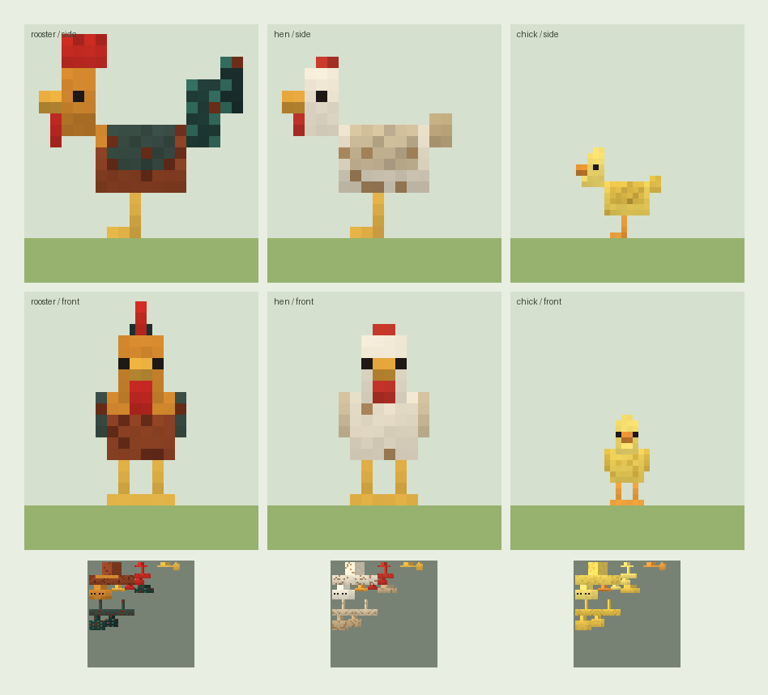

# Kaleidoscope_Ranching_BR
《森羅物語：樂牧》是一款以「養動物」為主題的 Minecraft 基岩版附加包，把原版「餵兩下就繁殖」的牲畜，變成需要照顧、也會以品質回報你的牧場。 它以《森羅物語：廚房》v1.6.6 為宿主，透過廚房公開的擴充 API 註冊食譜與手冊內容，不修改廚房本體。

## 文件

- [企劃書（正式版）](docs/PROPOSAL.zh-TW.md)
- [腳本架構](packs/BP/scripts/ARCHITECTURE.md)

## 目前進度

里程碑 M0（規格定稿）的內容已就緒，等待美術樣張確認：

- 四張資料表：[動物](packs/BP/scripts/data/animals.js)、[飼料](packs/BP/scripts/data/feeds.js)、[加工配方](packs/BP/scripts/data/processing.js)、[屠體分切](packs/BP/scripts/data/butcher.js)，以及物品與方塊的[名稱登錄表](packs/BP/scripts/data/items.js)。
- 專案骨架：行為包、資源包、與廚房的握手腳本、語言檔。
- 美術樣張：公雞、母雞、小雞。

目前的附加包只含一種可召喚的動物（`kaleidoscope_ranching:chicken`），用來在遊戲裡確認畫風；照顧、產蛋、屠體等玩法從 M1 起逐步加入。尚未在遊戲內實測。

## 資料夾

| 路徑 | 內容 |
| --- | --- |
| `packs/BP` | 行為包。`scripts/data/` 是所有動物、物品、配方的唯一來源 |
| `packs/RP` | 資源包 |
| `tools/` | 驗證、語言檔生成、美術生成、打包腳本 |
| `docs/` | 企劃書與美術預覽 |

## 開發指令

需要 Node.js 與 Python 3（含 Pillow）。

| 指令 | 作用 |
| --- | --- |
| `node tools/validate.mjs` | 檢查所有 JSON 語法，並交叉比對資料表 |
| `node tools/gen_lang.mjs` | 由名稱登錄表生成三種語言檔 |
| `python3 tools/gen_chicken.py` | 重新生成雞的模型、貼圖與預覽圖 |
| `bash tools/build.sh` | 打包成 `dist/` 下的 `.mcaddon` |

簡體中文語言檔的物品與方塊名稱暫時沿用繁體，待登錄表補上簡體欄位。
