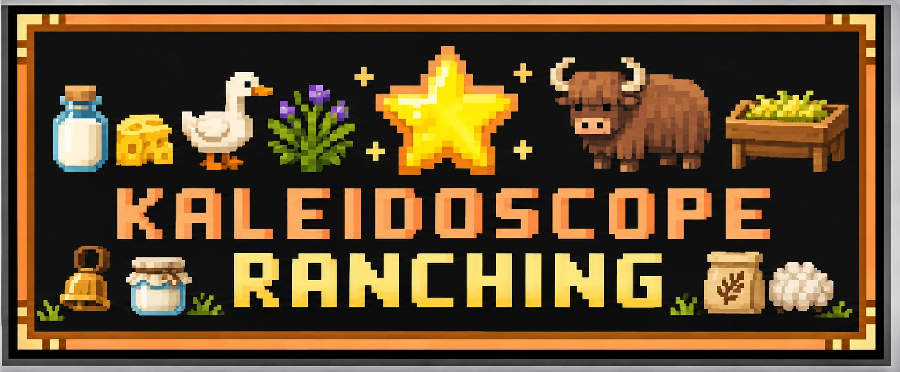
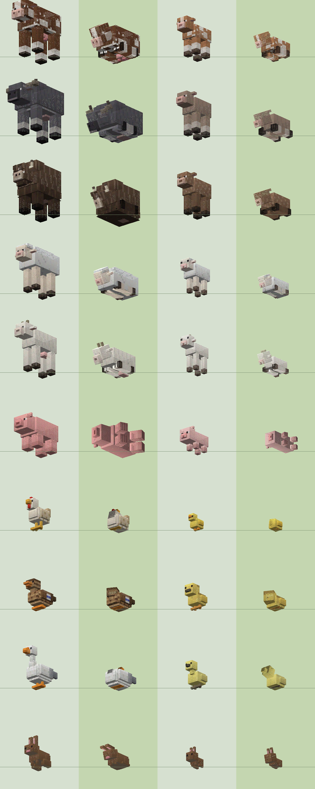
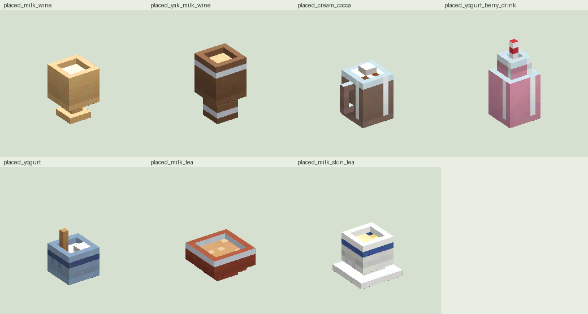
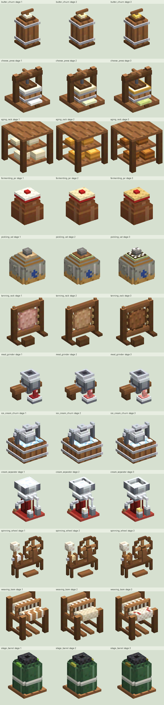

# 森羅物語：樂牧（Kaleidoscope Ranching）

《森羅物語：樂牧》是一款以「養動物」為主題的 Minecraft 基岩版附加包，把原版「餵兩下就繁殖」的牲畜，變成需要照顧、也會回報你的牧場。它以《森羅物語：廚房》v1.6.6 為宿主，透過廚房公開的擴充 API 註冊食譜與手冊內容，不修改廚房本體。非官方作品。

## 特色

- **十種動物**：牛、羊、山羊、豬、雞、兔、水牛、氂牛、鴨、鵝，分公母、會懷孕、夜裡會趴下睡覺。
- **照顧與回報**：餵食、梳毛、好感度、生病與獸藥；照顧得好才繁殖、才多產。
- **從牧場到餐桌**：屠宰掛架分切、風乾與醃製、擠奶與乳酪、蛋與孵化、皮革與毛料，最後在《廚房》的鍋具裡做成 50 多道料理，每個部位的肉都有菜可做。
- **沉浸式**：遊戲畫面不跳任何提示文字。進度直接看得到：掛架上的肉條隨風乾變深、加工設備裡的東西分三階段變色、蛋隨孵化出現裂紋、孵化器沒熱源時燈會暗、照蛋器能讓蛋透光看見雛形。
- **擺上桌**：乳酪輪、披薩、燉鍋、焗烤可以放在地上大家分著吃；奶酒、奶茶、可可飲、酸奶等七種飲品也能擺著喝。吃飽了照樣能吃。
- **圖鑑**：《廚房》手冊裡的樂牧章節收錄每種動物、工具、設施與食物的取得方式和用法，繁中、簡中、英文三語。

## 文件

- [企劃書（正式版）](docs/PROPOSAL.zh-TW.md)
- [1.1 追加企劃書：草場與新夥伴](docs/1.1_追加企劃書.md)
- [專案架構](docs/ARCHITECTURE.md)：接手前先讀
- [腳本架構](packs/BP/scripts/ARCHITECTURE.md)
- [里程碑之間的介面](docs/INTERFACES.md)
- [M2 照顧核心交接說明](docs/M2_交接.md)
- 1.0 各階段說明：[M3 屠宰與乳蛋加工](docs/M3_說明.md)、[M4 新動物](docs/M4_說明.md)、[M5 廚房料理與整合](docs/M5_說明.md)
- 1.1 各階段說明：[M7 肉類與內臟](docs/M7_說明.md)、[M8 蛋奶與起司](docs/M8_說明.md)、[M9 皮革、絨毛、布料與孵化飼料](docs/M9_說明.md)、[M10 役用、管理與作息](docs/M10_說明.md)、[M11 健康、API 與握手](docs/M11_說明.md)
- 1.1 發佈文件：[1.1 更新說明](docs/RELEASE_NOTES_1.1.md)、[1.1 發佈頁文字](docs/RELEASE_PAGE_1.1.md)
- [對外擴充 API](docs/API.md)（範例附加包在 `examples/api-example/`）

## 目前進度

| 里程碑 | 狀態 |
| --- | --- |
| M0 規格與骨架 | 完成 |
| M1 自有動物與性別 | 完成；1.1 重做造型 |
| M2 照顧核心 | 由另一位開發者完成，已整合 |
| M3 屠宰與乳蛋加工 | 完成；規則見 [M3 說明](docs/M3_說明.md) |
| M4 新動物與搬運道具 | 完成；見 [M4 說明](docs/M4_說明.md) |
| M5 對外 API、廚房料理與手冊 | 完成；規格見 [API 文件](docs/API.md)，料理見 [M5 說明](docs/M5_說明.md) |
| M6 光影、平衡、三語 | 三語與光影材質完成；數值平衡待實測後調整 |
| 1.1 M7～M11 | 程式完成；見各階段說明 |
| 1.1 美術收尾 | 可放置料理與飲品、穿戴物與動物裝備、掛架風乾、M1 動物造型與睡姿、加工與孵化的進度外觀、圖鑑 |

遊戲內實測進行中。實測找到並已確認修好的：動物站著與睡著時腿的角度、飼料槽與堆肥桶的配方載入失敗。睡姿貼地閃爍、圍巾與皮圍裙不顯示已修正，待實機確認；其他內容通過模擬腳本 API 的測試，也待實機確認。發佈 1.1 前還要做的事見 [1.1 收尾企劃書](docs/1.1_收尾企劃書.md)。

## 資料夾

| 路徑 | 內容 |
| --- | --- |
| `packs/BP` | 行為包。`scripts/data/` 是所有動物、物品、配方的唯一來源 |
| `packs/RP` | 資源包 |
| `tools/` | 驗證、語言檔生成、美術生成、打包腳本 |
| `docs/` | 企劃書與美術預覽 |

## 物品圖示（RetroDiffusion）

物品圖示可以用 RetroDiffusion 重畫：提示詞在 `tools/art/icon_prompts.json`，流程寫在 `tools/art/rd_icons.py` 開頭。要在連得到 RetroDiffusion 的環境執行，金鑰放在環境變數 `RETRODIFFUSION_API_KEY`，不要寫進檔案或貼到任何地方。選定的圖示存在 `art/icons/`，`npm run generate` 會套用；還沒選的維持程式畫的版本。

## 開發指令

需要 Node.js 與 Python 3（含 Pillow）。

| 指令 | 作用 |
| --- | --- |
| `npm run generate` | 重新生成動物美術、M2 內容、實體檔，再組合語言檔與貼圖索引、套用挑好的圖示，最後生成光影材質檔 |
| `npm run validate` | 檢查 JSON 語法、交叉比對資料表與資源包連結，以及每張貼圖的光影材質組與 MERS、法線圖是否齊全、尺寸相符 |
| `npm test` | 以模擬的腳本 API 執行行為測試（M1 到 M11、對外 API 與範例附加包） |
| `npm run build` | 驗證、測試，然後打包成 `dist/` 下的 `.mcaddon` |

生成的檔案（動物模型、貼圖、實體 JSON、語言檔、`*.texture_set.json` 光影材質檔）請改生成器，不要手改。每張貼圖的基本材質寫在 `tools/gen_pbr.py` 的 `RULES`，同一張貼圖裡的鐵件、玻璃、眼睛、粉色皮膚等再依顏色分（`classify`）。行為測試用的 `tools/test/mock-server.mjs` 只模擬腳本 API 的一小部分，通過測試不代表遊戲內一定正常。

簡體中文的物品與方塊名稱由 `packs/BP/scripts/data/zh_cn.js` 從繁體名稱轉換。
