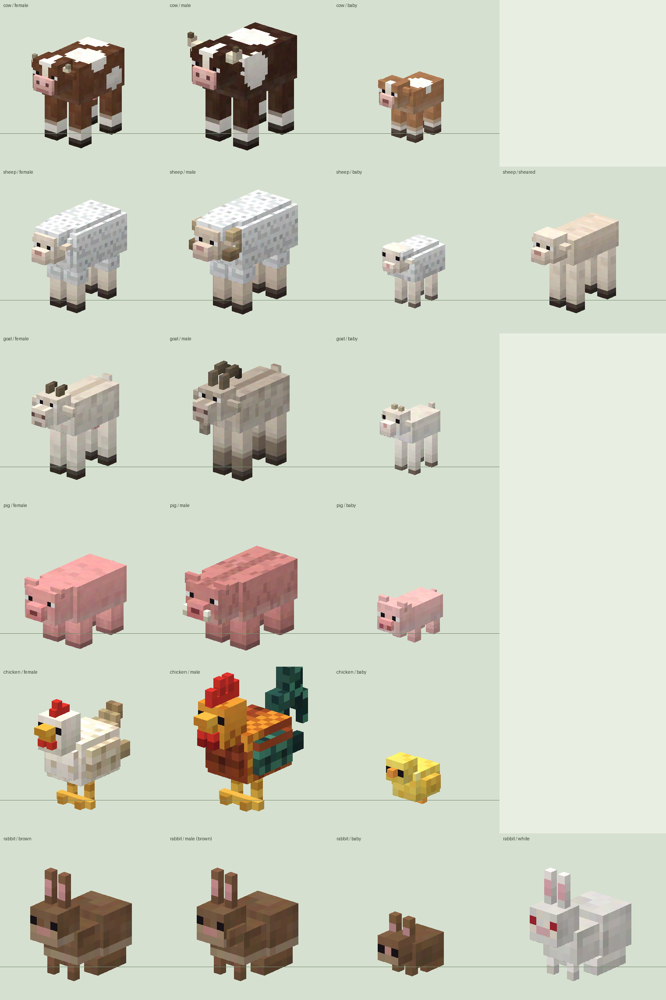
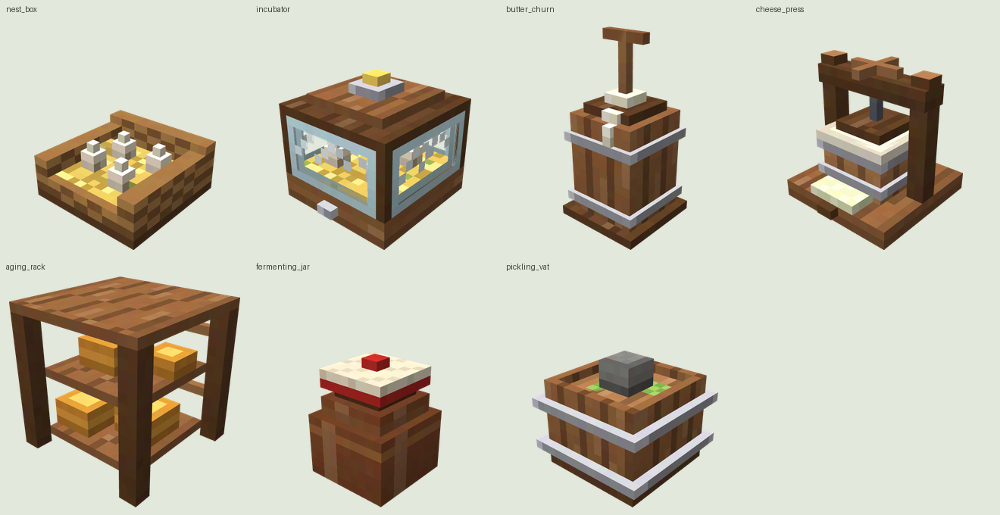

# Kaleidoscope_Ranching_BR
《森羅物語：樂牧》是一款以「養動物」為主題的 Minecraft 基岩版附加包，把原版「餵兩下就繁殖」的牲畜，變成需要照顧、也會以品質回報你的牧場。 它以《森羅物語：廚房》v1.6.6 為宿主，透過廚房公開的擴充 API 註冊食譜與手冊內容，不修改廚房本體。

## 文件

- [企劃書（正式版）](docs/PROPOSAL.zh-TW.md)
- [專案架構](docs/ARCHITECTURE.md)：接手前先讀
- [腳本架構](packs/BP/scripts/ARCHITECTURE.md)
- [里程碑之間的介面](docs/INTERFACES.md)
- [M2 照顧核心交接說明](docs/M2_交接.md)
- [M3 屠宰與乳蛋加工說明](docs/M3_說明.md)
- [對外擴充 API](docs/API.md)（範例附加包在 `examples/api-example/`）

## 目前進度

| 里程碑 | 狀態 |
| --- | --- |
| M0 規格與骨架 | 完成 |
| M1 自有動物與性別 | 完成，待實測 |
| M2 照顧核心 | 由另一位開發者完成，已整合，待實測 |
| M3 屠宰與乳蛋加工 | 完成，待實測；規則見 [M3 說明](docs/M3_說明.md) |
| M5 對外 API | 完成，待實測；規格見 [API 文件](docs/API.md) |
| M4 新動物與搬運道具 | 程式與美術完成，待實測；十種動物、乾草架、拴畜樁、屠宰掛架已換正式模型；見 [M4 說明](docs/M4_說明.md) |
| M5 廚房料理與手冊 | 完成，待實測；漁歌已接（魚雜、魚骨當家禽飼料），煙火 1.0 不接；見 [M5 說明](docs/M5_說明.md) |
| M6 光影、平衡、三語 | 簡體中文名稱完成；光影：方塊、物品、動物全部貼圖都有逐像素的 MERS（金屬、自發光、粗糙、次表面散射）與法線圖（`tools/gen_pbr.py`），待遊戲內實測；數值平衡屬工作包 E，伺服器實測屬工作包 A |
| 1.1 M7 肉類線與內臟線 | 程式完成，美術為暫代，待實測；內臟分切、水槽清洗、絞肉機、掛架風乾、14 道料理；見 [M7 說明](docs/M7_說明.md) |

所有內容都只在模擬的腳本 API 上測過，尚未在遊戲內實測。

## 資料夾

| 路徑 | 內容 |
| --- | --- |
| `packs/BP` | 行為包。`scripts/data/` 是所有動物、物品、配方的唯一來源 |
| `packs/RP` | 資源包 |
| `tools/` | 驗證、語言檔生成、美術生成、打包腳本 |
| `docs/` | 企劃書與美術預覽 |

## 物品圖示（RetroDiffusion）

物品圖示可以用 RetroDiffusion 重畫：提示詞在 `tools/art/icon_prompts.json`，流程寫在 `tools/art/rd_icons.py` 開頭。要在連得到 RetroDiffusion 的環境執行，金鑰放在環境變數 `RETRODIFFUSION_API_KEY`，不要寫進檔案或貼到任何地方。選定的圖示存在 `art/icons/`，`npm run generate` 會套用；還沒選的維持程式畫的版本。

## 開發指令

需要 Node.js 與 Python 3（含 Pillow）。

| 指令 | 作用 |
| --- | --- |
| `npm run generate` | 重新生成動物美術、M2 內容、實體檔，再組合語言檔與貼圖索引、套用挑好的圖示，最後生成光影材質檔 |
| `npm run validate` | 檢查 JSON 語法、交叉比對資料表與資源包連結，以及每張貼圖的光影材質組與 MERS、法線圖是否齊全、尺寸相符 |
| `npm test` | 以模擬的腳本 API 執行行為測試（M1 到 M5、對外 API 與範例附加包） |
| `npm run build` | 驗證、測試，然後打包成 `dist/` 下的 `.mcaddon` |

生成的檔案（動物模型、貼圖、實體 JSON、語言檔、`*.texture_set.json` 光影材質檔）請改生成器，不要手改。每張貼圖的基本材質寫在 `tools/gen_pbr.py` 的 `RULES`，同一張貼圖裡的鐵件、玻璃、眼睛、粉色皮膚等再依顏色分（`classify`）。行為測試用的 `tools/test/mock-server.mjs` 只模擬腳本 API 的一小部分，通過測試不代表遊戲內一定正常。

簡體中文語言檔的物品與方塊名稱暫時沿用繁體，待登錄表補上簡體欄位。
