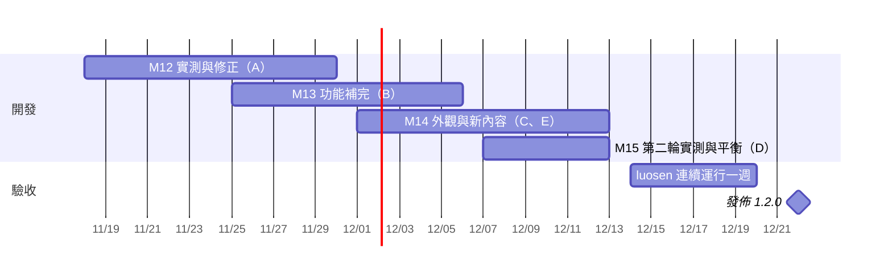

# 森羅物語：樂牧 1.2 改版企劃書

2026-11-17 起草。

## 改版概述

1.2 的主題是「實機穩定與補完」：把 1.1 只在模擬環境測過的內容帶進遊戲裡逐項確認，修掉找到的問題，補上 1.1 發佈時列在「已知限制」的缺口，並依實測調整數值。新內容只收幾樣小而完整的項目，不開新產線。

原本規劃的 1.2 內容已在 2026-11-16 併入 1.1，所以 1.2 沒有承接的待做清單，內容由本企劃書重新定義。

| 項目 | 內容 |
| --- | --- |
| 版本號 | 1.2.0（manifest 與 `PACK_VERSION` 同步） |
| 宿主 | 《森羅物語：廚房》v1.6.6，最低引擎 1.26.1，不變 |
| 對外 API | 協定版本 `api` 仍是 1，只新增能力，不改既有欄位 |
| 存檔相容 | 1.1 的存檔直接升級，不需轉換 |

三個目標：

1. **實機可信**：1.1 每條產線至少在遊戲裡完整跑過一次，伺服器連續運行一週沒有看門狗警告。
2. **補完已知限制**：1.1 更新說明列出的功能與外觀限制，能解的在 1.2 解掉，不能解的寫明原因。
3. **數值定案**：疾病、鈣質飼料、作息、加工時間、飽食度、馱袋格數依實測調整一次。

## 現況分析

1.1.0 已發佈（2026-11-17），程式與美術都做完，但大部分內容只在模擬的腳本 API 上測過。`npm run validate` 通過，行為測試 185/185 通過。

**已在遊戲裡確認的**：動物站著與睡著的腿部角度、飼料槽與堆肥桶的配方載入。發佈後又修了三個問題：乾草架近看閃爍（#52）、角骨粉與角杯配方衝突（#53）、奶茶放成碗而不是杯（#54）。

**還沒做的驗收**：1.1 各線的實機流程、系列握手（酒館、漁歌、廚房）、伺服器連續運行一週。後者是 M6 與 M11 共同的驗收標準，兩次都沒做。

[1.1 更新說明](RELEASE_NOTES_1.1.md)列出的已知限制，是 1.2 的主要來源：

| 已知限制 | 類別 | 1.2 處理 |
| --- | --- | --- |
| 毛帽、圍巾沒有細雪防凍效果 | 功能 | 做（B1） |
| 睡著時用剪刀剪毛不會吵醒 | 功能 | 做（B2） |
| 寒冷地區用腳邊的雪或冰判斷，不是生物群系 | 功能 | 評估後決定（B3） |
| 酒館缺液體能力時整份擴充可能被拒收 | 整合 | 做（B4） |
| 馱袋用表單操作；氂牛死亡時內容物是否掉出未確認 | 功能 | 實測確認，表單保留 |
| 地毯 16 色是同一張貼圖染色 | 外觀 | 做（C1） |
| 青貯料、鈣質飼料在飼槽借用別的外觀 | 外觀 | 做（C2） |
| 照蛋燈、加工設備、風乾肉條的顏色清不清楚 | 外觀 | 實測後調整 |
| 數值未依實測調整 | 平衡 | 做（D 線） |
| 魚漿、樂牧食材進漁歌鍋具 | 等外部 | 等漁歌開放配方註冊，不擋 1.2 |

照已定案的決策，煙火（Grilling）在 1.2 仍然不接。

玩家回饋：目前版本庫裡沒有收集到外部玩家的回饋，實測紀錄以開發者自己在 luosen 上的測試為主。

## 改版內容

1.2 分五條線：A 實測修正、B 功能補完、C 外觀補完、D 平衡、E 小幅新內容。A、B、D 是發佈的必要條件；C、E 沒做完可以延到 1.2.x。

設計原則沿用 1.1：能接在既有方塊上就不新增方塊、每個新物品都要有去處、系統不懲罰玩家、遊戲畫面不跳提示文字。

### A 實測修正（必要）

照[《1.1 收尾企劃書》](1.1_收尾企劃書.md)第一節的清單，在新世界或 luosen 的複本上逐項實測，問題逐一開 issue 並修正。

| 編號 | 範圍 | 要確認的事 |
| --- | --- | --- |
| A1 | 肉類與內臟線（M7） | 絞肉機配方；掛架在風乾與屠宰之間切換；水槽洗內臟；臘味煲仔飯、滷大腸從屠體做到完成 |
| A2 | 蛋奶與起司線（M8） | 擠奶架接漏斗三天免手動；奶油分離器自動化；四種奶壓出對應乳酪；7 天得陳年乳酪輪 |
| A3 | 皮革、絨毛、布料（M9） | 套索視線判定；紡車與織布機接容器；鈣質飼料多下蛋 |
| A4 | 役用與作息（M10） | 睡姿穿模或浮空；吵醒條件；趕畜推力；畜欄門；犁的耕地範圍 |
| A5 | 健康（M11） | 生病只停產不致死；獸藥、肥皂有效；關掉疾病後完全不觸發 |
| A6 | 可放置食物與飲品 | 乳酪輪切分、披薩與火鍋分四份、燉菜與焗烤分食、七種飲品 |
| A7 | 穿戴與動物裝備 | 穿戴物位置、手持圖示薄片的位置與大小、動物裝備跟著走路與睡姿 |
| A8 | 系列握手 | 廚房站點做得出新料理、手冊正常；漁歌魚餌、魚骨磨鈣粉、海鹽加快風乾；酒館收下擴充、酒桶奶的液面 |
| A9 | 伺服器 | luosen 連續運行一週，看門狗沒有警告；50 隻同時入睡、被吵醒不卡頓 |
| A10 | 光影與語言 | Vibrant Visuals 開、關各看一次；三語有無過長、斷行或漏翻 |

### B 功能補完（必要）

| 編號 | 項目 | 設計 |
| --- | --- | --- |
| B1 | 毛帽、圍巾防凍 | 先實測自訂穿戴物有沒有皮革的防凍效果。沒有的話，用腳本在細雪中替戴著的玩家清除凍結；只在玩家進入細雪時檢查，不做全域輪詢 |
| B2 | 剪毛吵醒 | 睡著時用剪刀剪毛會吵醒動物，規則與擠奶一致；皮手套同樣防吵醒 |
| B3 | 寒冷判斷 | 評估穩定版 `@minecraft/server` 2.7.0 能不能讀生物群系。能就改依生物群系，雪、冰的判斷保留為備援；不能就維持現狀，寫進已知限制。不用 beta 模組 |
| B4 | 酒館分批送 | 依酒館回報的能力清單，把奶酒、調飲、奶的液體拆成三份分別送出；缺哪項能力就只略過那份 |

### C 外觀補完（可延後）

| 編號 | 項目 | 設計 |
| --- | --- | --- |
| C1 | 地毯 16 色 | 每色各一張貼圖，由產生器輸出，不手改 |
| C2 | 飼槽內容物 | 青貯料、鈣質飼料在飼槽裡有自己的顏色與材質 |
| C3 | 受精蛋圖示 | 目前沿用一般蛋加標記，改成專用圖示（RetroDiffusion 生成後挑選） |
| C4 | 實測後的顏色調整 | 照蛋燈半透明蛋殼、加工三階段、風乾肉條，看不清楚的拉開對比 |

### D 平衡（必要）

數值都在 `data/` 的表格與各系統開頭的常數，調整不改邏輯。第二輪實測時一起調。

| 數值 | 目前 | 調整依據 |
| --- | --- | --- |
| 疾病發病機率與恢復速度 | 依 `systems/disease.js` | 照顧良好的牧場一週內極少發病 |
| 鈣質飼料多下蛋機率 | 30% | 不讓鈣質飼料取代照顧 |
| 睡得好與寒冷對好感度的加減 | 依 `systems/sleep.js` | 不懲罰偶爾忘記趕回畜欄的玩家 |
| 各加工方塊的時間 | 依 `data/processing.js` | 一天的照顧維持 2～3 分鐘 |
| 新料理的飽食度 | 依 `data/dishes.js` | 與廚房同等步驟的料理相當 |
| 馱袋格數 | 15 格 | 實測搬運手感 |

### E 小幅新內容（可延後）

| 編號 | 項目 | 設計 |
| --- | --- | --- |
| E1 | 牧羊犬零食 | 企劃書寫過但未實作：牛肉乾是牧羊犬愛吃的零食，沒用完的生內臟也能餵。牧羊犬是原版馴服的狼，對它使用即可餵食 |
| E2 | 公雞專用啼聲 | 目前是原版雞叫聲降三種音高接連播放，改成原創音效；只改 `systems/rooster.js` 的 `crow()` 與 `sounds.json` |

E1 的餵食效果還沒定，見文末「待決定」。

## 技術實作規劃

所有改動都沿用現有架構：`packs/BP/scripts/data/` 是資料的唯一來源，生成的檔案改產生器不手改，每項功能都補模擬環境的行為測試。

| 編號 | 主要檔案 | 做法 |
| --- | --- | --- |
| B1 | `systems/textiles.js`、`data/gear.js` | 只在玩家進入細雪時檢查頭部與胸部的穿戴物，清除凍結 |
| B2 | `systems/sleep.js`、`systems/textiles.js` | 剪毛事件接上既有的吵醒函式，與擠奶共用一套判斷 |
| B3 | `systems/sleep.js` | 寒冷判斷抽成一個函式，生物群系可讀時優先使用 |
| B4 | `api/tavern.js` | 依 `api_ready` 回報的能力清單分三份送出；測試模擬缺少各項能力的酒館 |
| C1、C2 | `art_src/m4_scripts/`、`tools/gen_pbr.py` | 產生器輸出新貼圖，每張都要有光影材質組，`npm run validate` 檢查 |
| C3 | `tools/art/icon_prompts.json`、`art/icons/` | RetroDiffusion 生成後挑選，金鑰只放環境變數 |
| D | `data/` 各表、各系統開頭的常數 | 只改數值；每次調整記在更新說明 |
| E1 | `systems/workAnimals.js`、`data/items.js` | 對牧羊犬使用牛肉乾或生內臟；只處理互動事件 |
| E2 | `systems/rooster.js`、`packs/RP/sounds.json` | 新音效為原創錄製或合成，不取用其他模組的資源 |

**對外 API**：協定版本 `api` 維持 1。若 E1 要開放給外部附加包（例如讓外部物品當牧羊犬零食），新增能力名稱 `dog_treat`，寫進 [API 文件](API.md)與範例附加包；不開放就不動 API。

**版本號**：發佈時同步改 `packs/BP/manifest.json`、`packs/RP/manifest.json` 與 `api/ranchingApi.js` 的 `PACK_VERSION` 為 1.2.0。

**每次合併前**：`npm run generate` 重跑沒有差異、`npm run validate` 通過、`npm test` 全數通過。每條線一個分支、一個 PR。

## 時程與里程碑

里程碑編號接續 1.1 的 M7～M11，從 M12 開始。日期是提案，依實測找到的問題量調整。1.2.0 預計 12/22 發佈，伺服器一週是最後一道關卡。

M12 與 M13 重疊一週：實測一找到問題就修，不等整輪跑完。伺服器一週要在 M15 數值定案之後開始，期間只修會讓伺服器卡頓或存檔壞掉的問題；跑完沒有看門狗警告才發佈。

## 驗收標準、風險與對策

### 驗收標準

1.2.0 發佈前全部要成立：

- [ ] A1～A10 每項在遊戲裡跑過，找到的問題都修掉，或寫進已知限制並說明原因
- [ ] luosen 連續運行一週，看門狗沒有警告；50 隻同時入睡、被吵醒不卡頓
- [ ] B1～B4 完成，B3 若不可行則寫明原因
- [ ] D 線六項數值定案，變動寫進更新說明
- [ ] 1.1 的存檔在 1.2 載入，動物、加工中的方塊、風乾中的掛架都保留
- [ ] `npm run build` 通過，版本號統一為 1.2.0
- [ ] 寫好 1.2 更新說明與發佈頁文字，標明「非官方」

### 風險與對策

| 風險 | 影響 | 對策 |
| --- | --- | --- |
| 實測找到的問題比預期多 | 時程延後 | A、B、D 先做；C、E 移到 1.2.x |
| 細雪中清除凍結只能用輪詢做到 | 違反「不拖慢伺服器」 | 只對戴著毛帽或圍巾的玩家、低頻率檢查；做不到就維持已知限制 |
| 穩定版 API 讀不到生物群系 | B3 做不了 | 保留雪、冰判斷，不用 beta 模組 |
| 廚房或酒館在開發期間改版 | 握手或食譜失效 | 只用 v1 公開事件，註冊前檢查能力清單；廚房改版後同步發佈相容版 |
| 數值調整讓舊存檔手感突變 | 玩家不適應 | 一次調一輪，幅度寫在更新說明 |
| 模擬環境測不到外觀與動畫 | 通過測試仍有問題 | 每個美術變動都進遊戲看一次再合併 |

### 待決定

- 牧羊犬吃零食的效果：只回血、趕畜範圍暫時變大，還是只有愛心粒子？
- 地毯 16 色各畫一張是否值得，還是維持染色？
- 公雞啼聲的音源：錄音還是合成？
- E1 要不要開放成對外 API 的新能力？
